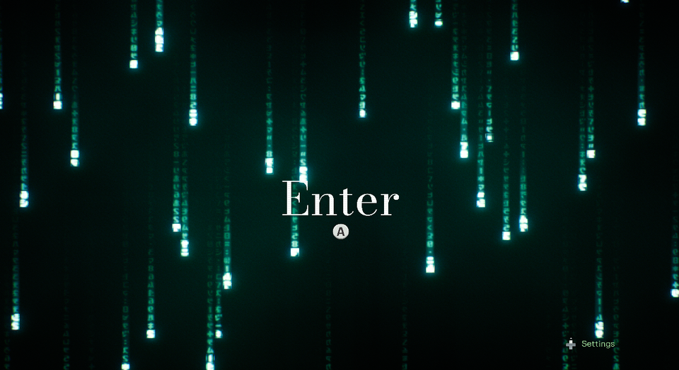

# Retail Enter screen on Linux

The Xbox Series package `1.20.1831.3754` renders the screen in the supplied
reference: green falling characters, **Enter** in the center, and **Settings**
in the lower right. The Xbox build draws an A button below Enter. Wine runs the
shipping AMD64 executable; D3D12X command lists reach Vulkan through the local
vkd3d-proton build on the RX 6950 XT.



[Full 3840×2160 GPU frame](evidence/enter-4k.png) ·
[3.2-second title-window recording](evidence/enter-window.mp4) ·
[Run log excerpt and hashes](evidence/enter-run.txt)

## What was verified

- A fresh player had no `FrostySaveData`. The game mounted its original
  content, entered `Startflow`, and Electra played the 21-second logo movie
  through its end.
- The shipping symbols name the reference screen `BP_CountdownUI`. Its
  post-release presentation says **Enter**. At RVA `0x024d9e6d`,
  `UFrostyUIComponent::SetCountdownUIActive` sets the active byte at `rdi+0x1e7`
  to 1. The [WineDbg script](../tools/enter-screen.dbg) breaks on the next
  instruction at `0x024d9e74`. The title also has a separately named
  `BP_MainMenu` with chase/sandbox choices.
- In `build/enter-verified-53`, WineDbg read `01` from the active byte.
  Frame 1536 was read back from the 3840×2160 Vulkan scanout. The lossless
  PNG decodes to the exact same RGB bytes as the original PPM.
  `requested-93078.window` identifies the matching GDK window as XID
  `12582913`, PID `160917`. The [recording](evidence/enter-window.mp4) contains
  48 distinct frames from that same title window at 15 fps.
- After the captures, an ordinary A-button input in that process reached
  `AFrostyGameState::RequestStateChangeToChase`, followed by the logged
  `Startflow` → `Chase` transition. The earlier independent run
  `build/menu-rain-sync-50` also captured the active Enter panel and its
  animated background.

## Why the missing pixels came back

The packaged `mfhevcdec.dll` accepts software NV12 output. `frosty-video.dll`
negotiates that type with the original transform and uploads its Y and UV
planes. Electra retrieves the Y resource, subresource index, and producer
fence from an `IMFDXGIBuffer`; its Xbox copy list resolves UV at the aligned
offset from the Y base address. The sample keeps its original timestamps.
At 0.500 seconds, all 2,160 luma and 1,080 chroma rows survived GPU readback.
The packaged decoder output, GPU readback, and independent FFmpeg reference
all had SHA-256 `e00a18d0e72641d9eb094a61489f933e3a105d6cdc8476425466e049a6cc0c6d`
(`build/media-probes/plane-check.log`).

The missing rain and icons had a different cause. An Xbox shader-resource
view can exist **before** the game fills its placed texture's backing memory.
In `build/menu-rain-textures-49/runner.log`, both the A and D-pad textures
contained zeros at placement. By frame 128 the same addresses contained the
exact 16,384-byte cooked BC3 payloads (FNV-1a `d979aa23efd3f251` and
`8f7dc3667110cb43`). The bridge now detiles the resident mips at first
shader use, honoring the actual view's mip and array ranges. The rain and
postprocessing use the title's compiled material shaders. The reference
screenshot is not a runtime input.

## Launching the current build

From `XBoxGame`, use the capture-free play launcher. On this machine it
finds the installed package under Downloads. Elsewhere, set `FROSTY_GAME_ROOT`
to the package or its `Mount` directory.

```bash
./Play
```

Allow the logo to finish and the prompt to fade in. Press controller A or
Enter to request the chase. The older `frame-*.ppm` files above came from
the retired diagnostic presenter.

An intermittent earlier boot stall can leave a white window with no presented
frames during `UFrostyGameInstanceBase::PreloadContent` (observed in
`build/enter-verified-52`). Relaunching the same executable, prefix and
player state succeeded in run 53.
