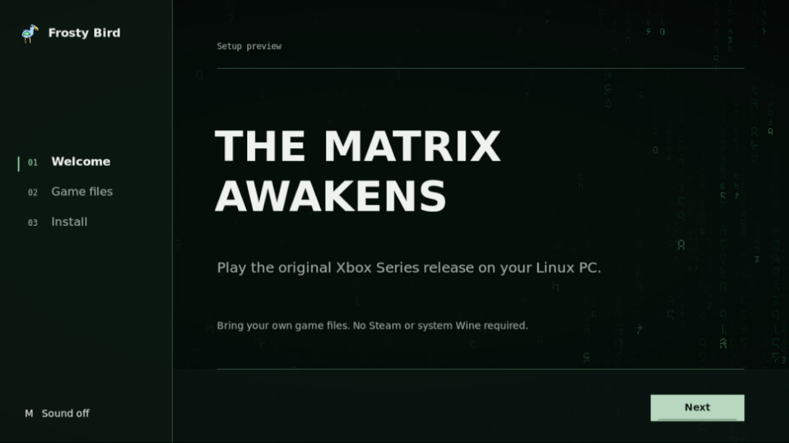

# Packaging Frosty Bird



[View the shader compilation screen](evidence/installer-shaders.jpg).

```sh
cmake --preset runtime
cmake --build build --target frostybird-zip --parallel 2
```

Publish `build/dist/FrostyBird-linux-x86_64.zip` and the adjacent `.sha256`
file as release assets. The player extracts the complete `FrostyBird/` folder
and runs `./frostybird`. This is a native Linux x86-64 ELF. The setup UI,
installer, launcher, live shader service and offline warmer are C++. The ZIP
includes the compiled Wine runtime, native and PE dependencies, AAC support,
Frosty Bird art and the installer Vorbis soundtrack. The statically linked entry
point starts the C++ player with the bundled ELF loader and matching glibc.
Setup relocates the three Wine ELF entry points for that same loader. The
Wine dependencies themselves are kept byte-for-byte and found through the
launcher's library path, without rewriting their RPATHs. The graphics driver
and desktop come from the host. There is no install-time
network, compiler or scripting-language dependency.

Builders also need SDL 3.2+, Pango/Cairo, libvorbisfile, nlohmann/json, `zip`,
`patchelf`, static C/C++ link libraries, and the GStreamer base/good/bad plugins including `faad`. Set
`-DFROSTY_BUILD_INSTALLER=OFF` for the original developer-only host/guest build.
`installer/package.sh` stages Wine using its `install-lib` target and assembles
the ZIP from an explicit set of runtime inputs. It does not package the source
workspace or a developer Wine prefix.

## Recorded shader workload

The release profile is `installer/assets/workload.json.gz`. It contains archive
locations, source hashes, view/payload parameters, root binding layouts and
pipeline state. It contains no shader bytecode, driver cache, log or save.
Ordinary release builds use the committed profile; only a maintainer refreshing
it from new runs needs a local workload and the matching original package:

```sh
build/host/installer/frostybird-profile \
  "$FROSTY_GAME_ROOT/Frosty/Content/Paks/Frosty-XSX.pak" \
  build/specializations build/play-runtime/rays build/rt-libraries \
  installer/assets/workload.json.gz
```

The installer checks each original against its SHA-256, selects the actual
adapter's compute capability mask, compiles the recorded variants, and rebuilds
native pipelines through vkd3d under the title's driver identity. Previously
unseen variants are compiled on demand by the same native cache service.
This reduces first-use stalls; it cannot eliminate all hitches.

Installation bakes Vulkan pipelines serially in a standalone, large-stack
Wine helper. The bar counts finished attempts, not jobs handed to workers.
For this helper only, vkd3d writes its cache synchronously and explicitly
closes the archive before signalling success. Game startup does not depend
on Wine's implicit cleanup after the cache has already been saved.
If a driver stops responding to a recipe, setup restarts the helper at that
recipe; persistent offenders are listed in `pipeline-result.txt` and left for
the on-demand path rather than blocking setup indefinitely.

The supplied profile contains 11,947 recorded variants and 3,857 graphics,
compute and ray-tracing pipeline recipes. The number shown during setup can be
smaller: recorded compute variants for distinct GPU masks are deduplicated
after the installer selects the local mask.

## Installed layout

The installation record is published after decoder registration, shader
translation and native pipeline preparation succeed. The completed release
and Wine prefix live under `$XDG_DATA_HOME/frostybird` (default
`~/.local/share/frostybird`); player files stay under `player/` across releases.
`$XDG_CACHE_HOME/frostybird` holds persistent caches. Vulkan data is tied to
the release; translated packets are tied to the actual compiler build.
The updated installer reuses DXC results from an earlier attempt if both
DXC libraries match. The desktop entry and `~/.local/bin/frostybird` point to the installed executable,
so the extracted download may be removed. Setup writes no files to the game
package. To update, extract the newer ZIP into its own folder and run its
`./frostybird --setup`. This also lets you select a moved game package.

`--preview` tours the wizard without installation. `--check DIR` checks the
package layout. For unattended setup use `--install DIR` (also launches on
success) or `--install DIR --no-launch`. When compilation starts, the setup
sidebar disappears and the Matrix rain fills the window, with the progress
bar and live shader or pipeline counts at the bottom center. `M` toggles both
the soundtrack and the original synthesized menu cues. If a
step fails, the wizard shows the error; Wine, adapter, pipeline and play logs
are under `instances/<release>/<package>/logs/`.

### Maintainer checks

With the ZIP extracted, the preview check runs the real wizard on a private
display and captures the shader progress screen. The audio test measures all
six cues and the muted output through SDL's postmix callback:

```sh
bash tests/installer_preview.sh /path/to/frostybird /path/to/new-test-dir
cmake --build build/host --target frostybird-cue-check
build/host/installer/frostybird-cue-check
```

`tests/installer_e2e.sh` takes the ZIP,
an original game folder and a new test directory; it exercises a clean install,
automatic launch and a second launch after the extracted download is moved.
These use Gamescope and a private PulseAudio sink and do not use the desktop
Wine prefix or player data.
